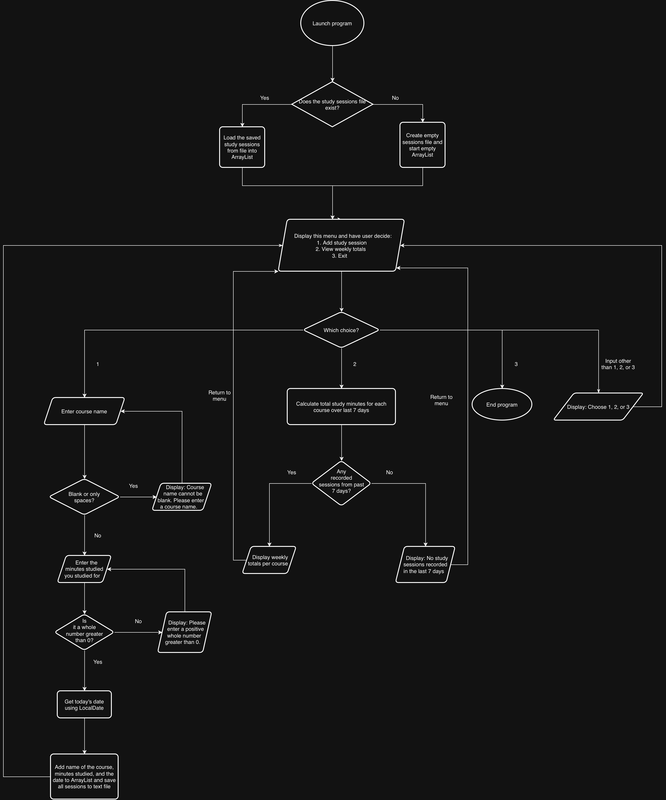

# StudyTracker

A Java program for tracking study sessions and weekly totals by course.

## The Problem

I have trouble keeping track of how much time I spend studying for each course. I want to know whether I spend too much time on one class and not enough on another.

## How It Works

I'm going to build a Java command line program that lets me record the course, date, and time spent studying per session.

The MVP will:
- Let the user enter a course name and minutes studied.
- Automatically record today's date.
- Reject blank course names and invalid minutes.
- Save sessions to a text file and load them when the program launches.
- Display total study minutes for each course over the last 7 days.

### System Diagram

## Tech Stack

- Java
- IntelliJ IDEA used for development
- Scanner for user input
- ArrayList to store study sessions while the program runs
- LocalDate to record dates and find sessions from the last 7 days
- BufferedReader and PrintWriter to read and write sessions to a local text file

Each saved study session will have the course name, date, and minutes studied. No external libraries or data sources will be used.

## Setup

Instructions for compiling and running the program will be added during development.

## Usage

The planned terminal menu will have only three options for the user to choose from:
1. Add a study session.
2. View study totals for the last 7 days.
3. Exit program.

## Roadmap

- [ ] Set weekly study goals for each course.
- [ ] Show percentage of study time spent on each course.
- [ ] Compare weekly totals with study goals and previous weeks.

## Author

Richie Martin, [Github](https://github.com/rmartin-ds)
